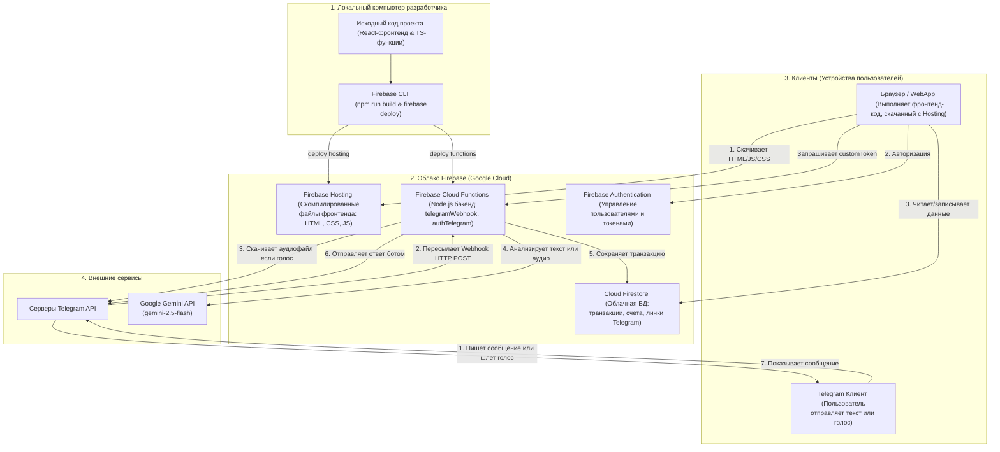

# Архитектура проекта Finance Tracker (Фронтенд, Бэкенд, База данных и Telegram)

Этот документ описывает устройство проекта, где хранятся его компоненты, как они взаимодействуют друг с другом и как работает синхронизация между локальным компьютером и облаком Firebase.

---

## Схема взаимодействия компонентов

---

## Где и что хранится?

| Компонент | Локально (на вашем ПК) | В облаке (Firebase / Google) | Что именно там лежит? |
| :--- | :--- | :--- | :--- |
| **Фронтенд (Интерфейс)** | Папка `src/`, `public/`, `index.html` (исходники) | **Firebase Hosting** (после сборки `npm run build` файлы из папки `dist`) | Статические файлы сайта. Выполняются непосредственно в браузере пользователя. |
| **Бэкенд (Функции)** | Папка `functions/src/` (исходный код на TypeScript) | **Firebase Cloud Functions** (скомпилированный JS-код Node.js) | Логика обработки вебхуков Telegram, генерация токенов авторизации. |
| **База данных** | Отсутствует (нет локального сервера БД) | **Cloud Firestore** (NoSQL СУБД) | Документы в коллекциях: `accounts` (счета), `categories` (категории трат), `transactions` (операции), `telegramUsers` (связи аккаунтов), `pendingTransactions` (ожидающие подтверждения). |
| **Авторизация** | Отсутствует | **Firebase Authentication** | Записи о пользователях (email, ID, сессии входа). |
| **Ключи доступа (Secrets)** | Файл `.env` (только для локального запуска) | **Secret Manager** (внутри Cloud Functions) | Защищенные ключи API (например, `GEMINI_API_KEY`, `TELEGRAM_BOT_TOKEN`). |

---

## Как происходит обмен данными?

### А. Ввод трат через Telegram-бота (Голос/Текст)
1. Пользователь записывает аудио-трату в Telegram.
2. Сервер Telegram отправляет HTTP POST запрос (Webhook) на адрес функции `telegramWebhook` в Firebase.
3. Функция скачивает файл из Telegram по `file_id`.
4. Функция отправляет аудиофайл в **Gemini 2.5 Flash** с системными инструкциями (включая сопоставление основной карты **KB MAIN**).
5. Gemini возвращает структурированный JSON (категория, сумма, счет, дата).
6. Функция создает документ в коллекции `transactions` в облачной базе данных **Firestore** и отправляет пользователю в Telegram ответ: *"Успешно добавлено!"*.

### Б. Работа приложения в браузере
1. Пользователь заходит по ссылке. Браузер скачивает с **Firebase Hosting** готовые файлы интерфейса.
2. Приложение запускается на устройстве пользователя.
3. Приложение подключается к **Firestore** и подписывается на изменения транзакций в реальном времени.
4. Как только Telegram-бот добавляет транзакцию в облачный Firestore, веб-приложение мгновенно видит её и обновляет балансы на экране.
